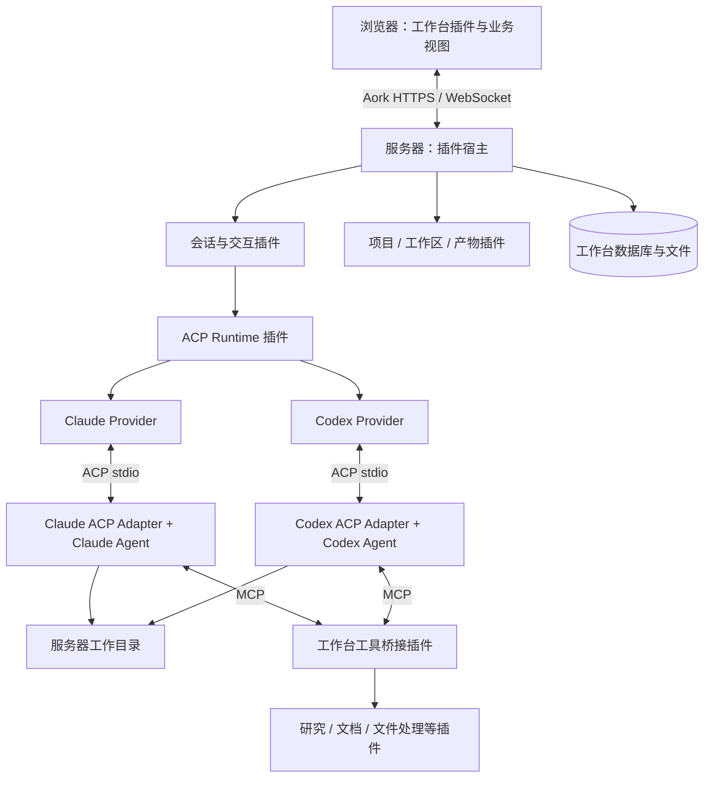

# Aork 产品设计记录：规格整理前的依据

> 本文保留 2026-11-15 调用 to-spec 前的产品草案、调研依据和评论。当前实施范围与验收以[正式规格](/Users/yangdi/code/multai/Aork/.scratch/plugin-ai-workbench/spec.md)为准；本文不另立平行规格。

日期：2026-11-15  
状态：产品设计草案；技术选型已细化为[技术架构基线 v1](/Users/yangdi/code/multai/Aork/.scratch/plugin-ai-workbench/technical-architecture.md)。文档不代表已实现功能或已完成兼容性验证。

## 1. 已确认的产品方向

- 参考 `/Users/yangdi/code/gh/deepseek-harness` 的插件架构。
- 一切业务能力通过插件提供，包括工作台界面和 Agent 接入。
- Claude、Codex 等外部 Agent 通过 Agent Client Protocol（ACP）接入；Aork 不内置主导它们的 Agent 循环。
- 首版是个人远程工作台：浏览器访问，Agent、凭据和工作区在服务器上。
- 面向通用工作：编程、研究、文档、文件处理都由插件提供，Git 仓库不是使用前提。

本文其余内容是建议方案。首版采用单台 Linux 服务器、单一工作台用户、可信已安装插件；明确的技术边界以技术架构基线为准，依赖补丁版本和接入兼容性在首次工程落地时锁定与验证。

## 2. 产品定位与关键差异

**Aork 是外部 Agent 的工作环境与交互宿主。Claude／Codex 负责推理和执行，Aork 负责让它们在可管理、可扩展、可恢复交互的工作环境中工作。**

| 维度 | 参考项目 dsh | Aork 建议 |
| --- | --- | --- |
| 默认执行主体 | dsh 自有 `ReactLoopAgent` | 用户选择的 Claude／Codex／其他 ACP Agent |
| 模型调用与工具循环 | dsh 装配 prompt、调用模型、执行工具、继续循环 | 由外部 Agent 自己管理 |
| ACP 客户端的角色 | dsh 主 Agent 的一次性 subagent provider | 工作台的主要 Agent 连接方式，支持持续会话 |
| 插件重点 | 可替换的 Agent 服务与 UI | 可替换的工作环境、Agent provider、业务工具与 UI |
| 持久化边界 | 自有日志可以用于推导模型历史 | 工作台记录与 Agent 内部历史分别管理 |

dsh 已经支持调用外部 ACP Agent。变化在于外部 Agent 在 Aork 中是第一等执行主体，而不是 dsh 循环中的一个工具或子代理。[D1][D2]

## 3. 架构路径选择

| 路径 | 优点 | 代价 | 结论 |
| --- | --- | --- | --- |
| 直接 fork dsh，替换主 Agent | 可以沿用大量现成基础设施 | session、UI、工具与主循环语义需要系统改造，容易留下 dsh 所有权假设 | 不作为首选 |
| 新建小内核，借鉴插件框架，业务全部由默认插件组成 | Agent 所有权清楚；插件与 ACP 分工独立；远程单机部署简单 | 需要重新实现长期会话、交互和恢复 | **推荐** |
| 插件全部拆成独立服务或进程 | 可独立部署，故障边界清楚 | RPC、版本、认证、数据一致性成本过高 | 有隔离需求时按边界演进 |

技术基线选定 TypeScript／Node.js 24 LTS、Fastify 5、React 19／Vite 和 SQLite WAL；`@deepseek-ai/cordis` 4.1.0 作为私有插件内核基础，公开接口由 Aork SDK 定义。插件输出独立 server／client 产物，支持运行时安装装配，升级采用排空、重启与页面刷新。这些技术不直接成为业务插件的内部依赖，细节见技术架构基线。

## 4. “一切皆插件”的准确边界

**所有用户可见业务都可以由插件组成、替换、配置和扩展；内核只保留让插件可靠运行的机制。** 插件是一个可以独立配置、启停、升级的能力包，不是每个函数一个包，也不等于每个插件一个微服务。

最小内核保留：

1. 启动、插件清单解析、版本检查、依赖解析、生命周期与失败回收。
2. 带版本和作用域的服务注册／调用、命令分发、事件订阅。
3. 宿主资源原语：命名空间存储、事务、事件序列、进程句柄、凭据引用、日志。
4. 身份与能力检查的强制入口。认证方法可替换，未认证访问不能因插件缺失而放行。
5. 最小浏览器引导页和插件故障恢复入口；即使业务插件损坏，仍可诊断、停用和恢复。

内核不包含模型供应商、prompt 拼装、推理循环、工具选择、任务规划、项目管理、会话界面、文件树或 Git 逻辑。业务契约可以是独立版本化 SDK，但拥有业务状态和行为的仍是插件。

“可替换”不等于“运行中可随意卸载”：会话、认证等基础插件被当前 profile 依赖时，必须先停止受影响运行或替换实现。关掉某项能力也不会自动删除它的数据。

## 5. 部署与进程结构

- 浏览器只连接 Aork 服务；关闭标签页不会终止服务器中的会话。
- Aork 的浏览器 HTTP 协议负责命令和查询，WebSocket 负责事件与重连；它不是“ACP over WebSocket”。
- ACP 客户端运行在服务器；首版通过 stdio 启动 Agent adapter。官方当前定义的标准传输是 stdio，远程传输仍在演进。[A1]
- 默认每个活动会话独占一组 adapter／Agent 进程，便于取消、凭据绑定与故障定位。休眠后能否恢复取决于 provider 的能力。
- 运行监督器记录能够追踪的子进程，在停止时清理受管进程组。首版不开放持久后台任务；普通进程树管理对 Agent 自行脱离的进程只能尽力清理，不能等同于系统级进程容器。首版服务重启会中断活动执行，不承诺进程无缝接管。
- 预留 Runner 服务接口，封装工作目录、启动参数、挂载与进程控制。首版只有本机服务器 runner，不建设远程节点调度系统。

## 6. 插件模型

一个插件包可以同时提供服务端和浏览器入口，也可以只提供其中一侧。清单至少包含：稳定 ID、版本、宿主 API 范围、入口、必需／可选依赖、提供／消费的服务、贡献点、配置 schema、申请的宿主能力、数据迁移版本。

声明能力不代表自动授权。浏览器请求必须在服务端重新验证；插件之间使用已声明的服务契约，不能直接读取其他插件的表或导入内部实现。核心依赖组成有向无环图；可选能力通过服务注册表发现。

| 插件类型／贡献点 | 提供什么 | 不自动获得什么 |
| --- | --- | --- |
| Agent provider | Agent 身份、安装检测、启动描述、认证配置、能力差异与兼容性信息 | 不重新实现 Agent 推理循环 |
| 服务插件 | 工作区、会话、产物、索引、工具、编排等业务 API | 不直接跨插件访问数据库 |
| UI 插件 | 页面、导航、面板、命令、消息／产物渲染器、设置表单 | 不持有服务器凭据，不直接启动进程 |
| 工具／集成插件 | 可暴露给 Agent 的工具、外部服务连接、上下文资源 | 安装后不代表每个 Agent 自动可见 |
| 工作流插件 | 多会话的显式创建、交接、排队和结果收集 | 不是工作台隐藏的总控 Agent |

插件可贡献多个类型。例如文档插件同时提供产物渲染器、文档生成工具和导出命令。MCP 是工具桥接协议，ACP 是工作台与 Agent 的会话协议，Aork 插件协议负责扩展宿主，三者不互相替代。

生命周期建议为 `发现 → 校验 → 解析依赖 → 激活 → 运行 → 停止接单 → 释放资源 → 停用`。所有监听器、路由、UI 插槽和进程引用都必须归属某次激活并有 disposer。激活中途失败也要回收。[D3]

首版通过锁定版本的默认 profile 安装可信包；启停和升级经过兼容性检查与受影响运行检查。执行中的会话绑定创建时的 provider／adapter 版本和配置。安装／升级需要重启 Host，因此全部活动 Run 停止后才进行；仅对不重启的启停操作可以限制影响范围。不同时托管多个版本。升级前备份工作台数据库、Agent 原生状态、托管工作区和产物；外接目录明确记录为外部依赖并在恢复时校验。历史会话保存版本及状态目录引用；仅经恢复兼容性验证后迁移。旧版本无法运行且新版本未验证时，历史仍可读，但标为不可原生恢复。迁移失败时恢复旧版本和匹配的数据，不能仅回退代码。首版不做热替换运行中的 adapter，不自动升级到 `latest`，不建设公开插件市场。

## 7. 默认插件组合

下列为逻辑包边界，不要求各自部署服务；每个包可以包含多个紧密相关的视图和服务。

| 默认插件 | 服务端职责 | 浏览器贡献 |
| --- | --- | --- |
| `auth-single-user` | 单用户登录、会话验证、登出 | 登录与账号设置 |
| `workbench` | 布局偏好、导航状态 | 主布局、命令入口、插件管理 |
| `workspace` | 项目、普通目录工作区、文件操作、写入占用 | 项目导航、文件浏览 |
| `sessions` | 会话、输入队列、turn 生命周期、事件投影 | 会话列表、对话、Agent 配置 |
| `interactions` | 权限请求与结构化输入的持久化投影、有效性检查 | 全局待处理列表、审批与输入卡片 |
| `runtime-acp` | ACP 连接、协商、事件映射、运行监督 | 连接与能力诊断 |
| `agent-claude` / `agent-codex` | 各自的启动、认证与兼容性配置，复用 ACP Runtime | Agent 选择与设置 |
| `artifacts` | 产物登记、版本引用、来源与访问 | 文件／文本／链接等基础预览与下载 |
| `tools-mcp` | 将选定插件工具按会话范围暴露给 Agent | 工具启用范围与连接状态 |

编程插件组可以增加 Git、diff、终端；研究插件组增加网页资料、引用与报告；文档插件组增加格式生成、预览与导出。它们都依赖通用工作区和产物接口，核心会话流程不要求安装 Git。

Skills、提示模板、原生 Agent 插件是另一类配置资源。Aork 可以管理和按 provider 映射它们，但不能假定 Claude 与 Codex 的原生插件／Skill 格式互通；映射结果必须可见，不能默默改写用户已有配置。

## 8. ACP 接入与职责

Aork 在 ACP 中是 Client；各 adapter 是 Agent 端。优先复用维护中的 adapter，而不是自行解析 CLI 的终端文本：Claude adapter 基于 Claude Agent SDK，Codex adapter 连接 Codex App Server。[A2][A3]

每个 provider 描述启动命令与参数数组、受控环境变量、配置目录、凭据引用、所需二进制版本和兼容性报告；浏览器不能提交任意命令替代已注册的启动描述。登录需要交互终端或回调时，由 provider 明确提供远程登录流程，不能假定服务器的 `localhost` 等于用户浏览器的 `localhost`。

一次会话的流程：

1. 用户选择项目、工作区、Agent 与启用的工具集；服务器保存配置快照。
2. ACP Runtime 获取工作区使用权，启动对应 adapter，执行 `initialize`。
3. 记录协议版本、Agent 信息及协商能力；按 advertised auth flow 认证。
4. 使用真实服务器 `cwd` 和 MCP 配置创建会话；仅在支持时加载旧会话。
5. 持久化用户输入后交付 `session/prompt`；接收更新并生成工作台投影。
6. 路由 Agent 的权限／结构化输入请求；完成时记录 stop reason，释放会话内的 turn 执行槽位。工作区的写入占用另行管理，不因收到最终回答就自动释放。

建议以 ACP v1 稳定行为为首版基线；官方已列出的 v2 Draft 和 adapter 自定义扩展只有在双方明确支持并经过测试时才启用。没有协商到的能力视为不支持。[A4]

能力展示规则：

| 能力 | 工作台行为 |
| --- | --- |
| 文本消息、工具状态 | 通用时间线呈现，保留来源与协议类型 |
| 图片、附件、上下文资源 | 根据 prompt capabilities 启用输入，不支持时解释限制 |
| 模型、模式、推理参数 | 使用 Agent 返回的配置选项；不把两家参数硬编码为同一组值 |
| 恢复会话 | 仅在 provider 支持且具备持久化条件时显示可恢复 |
| 结构化用户输入 | 协商成功则显示表单；否则保留普通对话，不根据问号猜测待回复 |
| 文件与终端 client 能力 | 对应服务已安装、可授权、可测试时才声明 |
| 费用、用量、内部子代理 | 有真实事件才展示；缺失显示未知 |
| 未识别扩展 | 保存受控的诊断信息、显示安全的通用占位，不执行未知动作 |

`session/update` 中的工具调用是 Agent 的执行报告；Aork 不能看到它就再次执行一次工具。Agent 可以直接使用自己的工具，也可以调用 Client 能力或被注入的 MCP 工具。[A5]

## 9. 领域模型与数据所有权

| 概念 | 定义与所有者 |
| --- | --- |
| Project | 一组持续工作的组织容器，由 workspace 插件管理；可以没有 Git |
| Workspace | 稳定 ID、runner、服务器目录及访问策略；路径不是身份 |
| AgentProfile | provider、adapter 版本、配置、凭据引用的组合 |
| Session | 用户与一个 Agent 的持续对话，由 sessions 插件管理 |
| AgentBinding | Session 与 provider、协议会话 ID、进程及连接代次的映射 |
| Turn | 一次输入到终止结果的执行单元，不等同于 Agent 内部一个模型调用 |
| Interaction | 需要用户行动的有效请求，区分 permission、form、url 等类型 |
| Artifact | 可查看、下载或再交给 Agent 的结果引用，记录文件／链接、版本、来源会话和 turn |

唯一写入所有者：`sessions` 维护持久化 Session、RuntimeRun 和 Turn；AgentBinding 是绑定关系，由 Session 的原生会话引用和 RuntimeRun 的连接代次表达，不单独建表。`runtime-acp` 维护运行操作队列、活连接、进程句柄和 RPC 请求句柄，并提交运行事实；`interactions` 维护待处理请求的持久化状态和投影。响应先原子领取请求，再由 Runtime 校验连接代次与原始请求是否仍有效后发送，记录本地响应已发送、失效或交付不确定的结果。Runtime 和 Interactions 不直接修改会话表；Session 状态由会话插件根据事实更新，避免三套状态源。

首版不增加独立 Task 领域对象。多 Agent 协作先表现为多个会话和明确的交接关系；工作流插件后续可引入自己的任务模型。

工作台保存会话索引、用户输入、接收到的协议事件、交互状态、AgentBinding、产物来源和配置快照。Agent 自己保存其内部上下文、压缩状态与原生历史。**工作台聊天记录不是可移植的 Agent 内存，也不保证覆盖 Agent 的全部活动。**

换 Agent 时创建关联的新会话，用户可选择共享文件、摘要和产物；不能把 Claude 的 session ID 交给 Codex，也不宣称无损迁移上下文。使用同一 provider 的 `session/load` 也必须先检查能力，并处理历史回放与现有投影的重复。[A6]

## 10. 持久化、并发与恢复

首版不构建通用分布式事件溯源平台。使用单机数据库事务维护领域状态与待发布事件，给工作台事件分配递增序号；前端通过快照加 cursor 增量订阅恢复。收到并成功落库的事件可重放；Agent 在崩溃前未交付或未落库的尾部信息不保证恢复。

必须维持以下约束：

- 每个会话只有一个运行所有者；每个会话同一时间最多有一个正在执行的 prompt turn。后续输入明确排队，首版不依赖 provider 专有 steering。
- 用户命令带唯一 ID，重复提交不重复创建会话／turn。发给 Agent 后丢失确认时标记交付状态不确定，不自动重发可能已有副作用的 prompt。
- 页面刷新、断网和多标签页连接不改变服务器所有者。多标签页响应同一请求时，只有一次状态转换可以成功。
- 前端快照与事件序列边界一致；cursor 过旧时获取新快照，不能通过无限重播重复拼接消息。
- 原始协议数据只保存产品诊断所需部分，凭据与认证载荷不进入事件流。大文件保存在文件存储中，事件只引用；设保留期限和大小限制。

| 情况 | 用户可见结果与恢复动作 |
| --- | --- |
| 浏览器断开，服务器和 Agent 仍在 | 执行继续；需要输入时保持请求；重连获取当前状态与有效请求 |
| 用户停止 | 标为取消中，发送 ACP 取消；取消待审批；收到终止结果才标记取消完成；超时按进程树终止并记录原因 |
| Agent 或 adapter 崩溃 | turn 标为中断；保留已接收内容和文件；原连接上的交互失效 |
| Aork 服务重启 | 清理或确认旧进程已结束，再允许新所有者启动；活动 turn 标为中断，不假装继续运行 |
| 支持恢复且原生历史仍可用 | 用户恢复原 Session，重新协商、加载历史；只切换 Agent 历史投影，工作台输入、交互与产物记录保留；队列需用户明确继续 |
| 不支持恢复或原生历史丢失 | 历史保持可查看，创建关联新会话，可选择携带摘要／文件 |
| 工具插件故障 | 将错误交给调用方，显示失败；不伪造成功结果 |

权限请求和结构化输入是与连接绑定的请求。数据库里的卡片仅为持久化投影，不能跨进程重启复活已失效的 RPC；连接代次变化后旧卡片必须失效。暂停、取消和审批也不承诺回滚已完成的文件修改或外部副作用。[A7][A8]

工作区默认允许多个会话存在，但只允许一个活动写入会话占用同一目录。活动 Runtime 存续、等待审批／输入、取消中和进程状态未知时保留占用；结束／休眠该运行并确认受管写入任务停止后才释放。不能确认停止时工作区保持受阻，展示诊断并要求用户在服务器确认清理。首版待处理请求不自动批准，默认持续等待至用户处理、显式取消或所属连接失效。并行执行默认分配独立工作区；编码场景可由 Git 插件创建 worktree。占用必须覆盖 Aork 发起的文件写入和 MCP 工具调用，不能只限制聊天输入。该机制只协调 Aork 受管操作，无法保证阻止外部手动写入或未被追踪的原生后台进程；它是一致性约束，不是操作系统沙箱。

## 11. 工具、上下文与产物

- 工具插件通过 `tools-mcp` 暴露经过选择的工具集，由 ACP 的会话配置交给 Agent；新安装的工具默认不加入现有会话。
- MCP 调用绑定会话、工作区和授权范围，不能信任 Agent 自行填写的 session ID 作为访问凭证；连接凭据仅授予当前运行。
- 首版基线为每个运行独立的 stdio MCP 桥接进程，由 Agent 按 Aork 提供的 MCP 配置启动，再经服务器受保护的本地 IPC 连接工具服务。宿主发放短期运行令牌并绑定真实身份；运行结束或桥接连接撤销后令牌失效。HTTP MCP 仅在能力协商和接入测试通过后使用，不假设所有 adapter 支持。令牌不提供针对同系统用户恶意代码的隔离。
- 工具和资源分别建模：工具执行动作，资源提供内容；模板／Skill 提供指导，不拥有执行权限。
- 产物以显式工具登记或用户确认登记为准；文件监视器可以显示候选新文件，但不能把目录里所有文件都归因为当前 Agent 的产出。
- 预览按 MIME 和已安装 renderer 选择；未知格式提供文件信息与下载。Agent 生成的 HTML 等内容置于隔离来源／受限 iframe 中，不能与带登录态的工作台同源执行。
- 第一个非编程验证场景：Agent 读取工作区资料，通过工具生成一份带来源的研究摘要或文档，并在产物面板预览、下载、重新作为上下文使用。

## 12. 工作台交互建议

默认布局由 `workbench` 插件提供，具体内容来自贡献点：

- 左侧：项目／工作区、会话与跨项目待处理入口。
- 中间：当前会话或插件主页面；会话顶部显示 Agent、工作目录和运行状态。
- 右侧：上下文与产物面板，可显示文件、资料、文档预览或插件视图。
- 按需区域：终端、改动比较、日志等，只有安装相应插件时出现。

基础贡献点建议为导航项、主页面、面板、命令、消息 renderer、产物 renderer、输入附件 provider 和设置页。首版不开放任意拦截核心 React 树或替换内部状态对象。

待处理和未读分开：待处理来自仍有效的权限／结构化输入请求；普通回答完成仅产生未读。用户打开过内容才清除对应未读游标。全局待处理视图只是投影，不成为第二套会话状态源。

用户路径：登录 → 选择或创建工作区 → 选择 Agent → 发送任务 → 查看执行／回答请求 → 查看产物 → 继续会话。无需配置 Git 或认识 ACP 才能完成首次任务。

## 13. 远程部署与信任边界

首版在单台服务器部署一个插件宿主、浏览器静态资源和若干 Agent 子进程，数据库和工作区持久化到独立目录。外部连接使用 HTTPS；登录态、WebSocket 来源和敏感命令都在服务端验证。首次初始化通过服务器上的一次性引导方式建立用户，不能留下公网匿名管理入口。

认证插件负责身份验证方式，内核负责强制执行验证结果。业务服务故障时不能退回匿名访问；插件恢复管理入口也必须通过身份验证。认证插件本身损坏时，浏览器入口保持拒绝，通过服务器本地恢复命令修复配置或回退版本。

Agent 凭据存放于服务器的受限凭据存储／provider 配置目录，以引用方式注入所需进程，不发到浏览器，不写进项目文件，不默认把宿主全部环境变量传给插件进程。需要 OAuth 回调、设备码或交互登录的流程，由 provider 实现并独立验收。

首版可信服务端插件可与宿主同进程；Agent 和 adapter 使用独立进程做故障与生命周期管理。**Cordis 作用域、声明的插件权限、Node 进程都不是恶意代码安全沙箱。** Agent 原生文件／shell 工具也未必经过工作台权限服务，因此不能声称 Aork 审计或拦截了所有操作。[D4][A5]

部署时以专用非特权系统用户运行，限定可访问目录。首版不支持不可信第三方代码、多租户隔离或任意插件代码的安全执行；引入这些能力时，需要容器／系统权限、网络和凭据隔离的独立设计，不能仅增加 manifest 字段。

## 14. 实施分段与验收标准

这是架构级分段，不是已排期的开发任务；批准设计后，每个独立能力单独细化规格和 issue。

### 第一段：插件宿主可组合

完成内核、manifest、服务契约、默认 profile、浏览器贡献点和命名空间存储。

验收：增加一个示例服务与 UI 插件不需要修改内核；停用后路由、监听器和插槽全部释放；依赖缺失时定位到具体插件；业务插件失败仍能进入受保护的恢复界面；认证服务失败时能通过服务器本地恢复。

### 第二段：两个真实 Agent 的远程会话闭环

完成单用户登录、普通目录工作区、ACP Runtime、Claude／Codex provider、流式会话、权限／输入交互和取消。

验收：在真实服务器和有效凭据下，两种 Agent 均能多轮对话、读写授权目录、产生工具状态、回答审批、调用一个通过 stdio MCP 桥接的工作台工具并取消；浏览器关闭后任务继续，重新打开可见最新状态。再注册一个通用 ACP 测试 provider，验证增加 provider 无需改动内核或会话主流程。不能用测试 provider 成功替代两种真实 Agent 的验收。

### 第三段：数据与中断可解释

完成事件游标、命令去重、历史恢复、工作区占用、产物登记和插件升级约束。

验收：重复点击不重复执行；两个标签页不能重复批准；旧连接请求不能被提交；服务与 adapter 崩溃后如实显示中断；支持恢复和不支持恢复两种路径均可验证；禁用插件不删除历史。

### 第四段：证明通用性

加入研究／文档中的一个完整插件组，再增加一个编码场景插件，验证它们只依赖公共服务。

验收：无 Git 的目录也能完成资料处理与产物导出；增加 Git／diff 插件后能完成代码任务；两类流程均无需修改会话内核和 Agent 接入代码。产物预览不能执行带工作台权限的生成脚本。

第一版完整交付需要上述闭环；只有插件加载器或聊天 UI 不算完成产品。公开市场、多用户、分布式 runner、自动多 Agent 编排和长期计划调度留在后续。

验证分两类：用协议测试替身覆盖协商、乱序、断线、取消、过期交互和幂等；用锁定版本的真实 adapter 与 Agent 验证登录、多轮、文件操作、恢复和工具桥接。兼容性矩阵按 provider／adapter／Agent 版本记录，不能把协议声明当成实现通过。

## 15. 调研依据

本地参考基线：deepseek-harness HEAD `39163dd30f`，2026-11-15 只读检查。以下为代码／文档证据，未运行 dsh 或做 Agent 实机验证。

- [D1] [dsh 自有 Agent 循环](/Users/yangdi/code/gh/deepseek-harness/packages/core/agent-loop/src/agent.ts:274)，[模型调用](/Users/yangdi/code/gh/deepseek-harness/packages/core/agent-loop/src/agent.ts:441)，[工具执行](/Users/yangdi/code/gh/deepseek-harness/packages/core/agent-loop/src/agent.ts:596)。
- [D2] [ACP subagent 的一次性运行限制](/Users/yangdi/code/gh/deepseek-harness/packages/subagent/subagent-acp/README.md:87)，[只收集文本和自动权限处理](/Users/yangdi/code/gh/deepseek-harness/packages/subagent/subagent-acp/src/run.ts:420)，[ACP server 限制](/Users/yangdi/code/gh/deepseek-harness/packages/acp/acp/README.md:174)。
- [D3] [插件服务分层](/Users/yangdi/code/gh/deepseek-harness/docs/architecture.md:136)，[可撤销注册](/Users/yangdi/code/gh/deepseek-harness/docs/cordis-primer.md:41)，[前后端插件图](/Users/yangdi/code/gh/deepseek-harness/docs/subsystems/client-modules.md:5)，[UI 插槽](/Users/yangdi/code/gh/deepseek-harness/packages/client/ui-slots/src/index.ts:100)。
- [D4] [host runner 不构成安全沙箱](/Users/yangdi/code/gh/deepseek-harness/packages/extensions/cordis-host-runner/README.md:64)。
- [A1] [ACP Transports](https://agentclientprotocol.com/protocol/v1/transports)。
- [A2] [Claude Agent ACP adapter](https://github.com/agentclientprotocol/claude-agent-acp/blob/main/README.md)。
- [A3] [Codex ACP adapter](https://github.com/agentclientprotocol/codex-acp/blob/main/README.md)。
- [A4] [ACP Initialization](https://agentclientprotocol.com/protocol/v1/initialization)，[协议目录与版本](https://agentclientprotocol.com/protocol/v1/overview)。
- [A5] [ACP Tool Calls](https://agentclientprotocol.com/protocol/v1/tool-calls)。
- [A6] [ACP Session Setup](https://agentclientprotocol.com/protocol/v1/session-setup)，[Session Config Options](https://agentclientprotocol.com/protocol/v1/session-config-options)。
- [A7] [ACP Prompt Turn](https://agentclientprotocol.com/protocol/v1/prompt-turn)，[Cancellation](https://agentclientprotocol.com/protocol/v1/cancellation)。
- [A8] [ACP Elicitation](https://agentclientprotocol.com/protocol/v1/elicitation)。

外部资料于 2026-11-15 查阅；描述的是当前资料，实施前仍需用选定版本验证。当前 Aork 目录仅有项目规范，未初始化 Git；本次输出是设计文档，不涉及应用实现或部署。

## Comments

- 2026-11-15：用户确认“个人远程工作台，浏览器访问，Agent 在服务器运行”。
- 2026-11-15：用户确认“通用工作台：编程、研究、文档、文件处理都通过插件提供”。
- 2026-11-15：用户要求先确定技术架构；新增技术架构基线、领域术语和三项 ADR，同步本规格的协议通路与运行实例定义。
