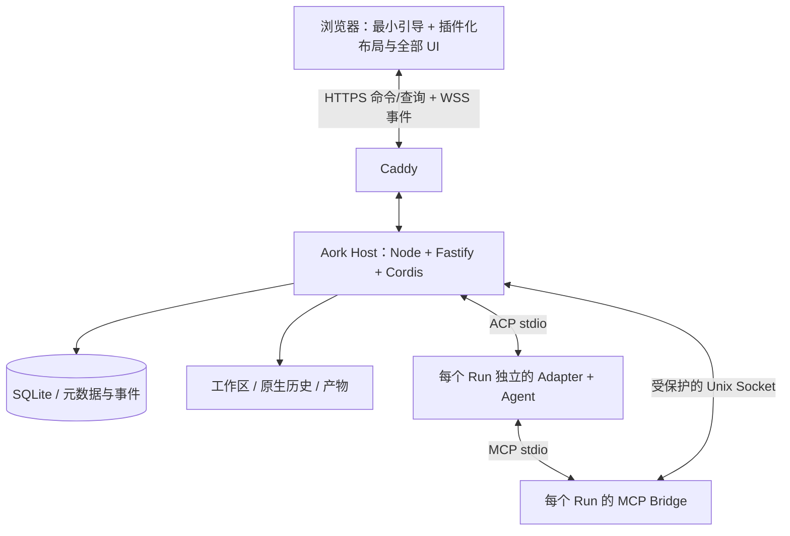

# Aork 技术架构基线 v1

日期：2026-11-15  
状态：本轮选定的技术方案，供评审；尚未实现、部署或完成兼容性验证。  
产品范围：[产品规格](/Users/yangdi/code/multai/Aork/.scratch/plugin-ai-workbench/spec.md)。术语：[GLOSSARY](/Users/yangdi/code/multai/Aork/GLOSSARY.md)。

## 1. 架构结论

采用 **TypeScript 模块化单体宿主 + 独立插件包 + 外部 ACP Agent 进程**。首版正式部署目标为单台 Linux 服务器，单用户通过浏览器访问。开发环境可以使用 macOS，但 Linux 的服务管理与进程清理必须单独验收。

Aork 内核提供插件运行机制；默认插件实现全部业务，包括所有正常产品 UI。整体布局、登录、会话输入和审批表单等均通过公开契约替换，不把插件能力局限为增加面板。会话控制属于工作台，模型调用、上下文压缩和工具循环属于外部 Agent。内核没有默认主 Agent，也不依赖 Claude／Codex。

| 范围 | 选定技术 | 选择依据 |
| --- | --- | --- |
| 语言与工程 | TypeScript strict、ESM、pnpm workspace | 服务端、浏览器和插件契约统一；按包限制依赖 |
| 服务端运行时 | Node.js 24 LTS，固定维护版本 | 官方仍支持的 LTS；为 ACP adapter 和原生依赖建立一条可复现基线，不追随每次新大版本 |
| 插件内核 | `@deepseek-ai/cordis` 4.1.0，封装为 Aork 私有适配层 | 复用参考项目的 DI、作用域和资源清理，不把其 Loader 配置暴露给插件作者 |
| HTTP / WebSocket | Fastify 5 + `@fastify/websocket` | 长驻 Node 服务，HTTP 入口与长连接独立于业务插件生命周期 |
| 浏览器 | React 19 + Vite，客户端 SPA | 面向登录后的工作台和实时状态；不需要 SSR 或全栈页面框架 |
| 前端状态 | TanStack Query 管理查询缓存；有序事件 reducer 管理当前会话流；React 管理局部界面状态 | 避免把高频消息流、服务器真相和布局状态混成一个全局 store |
| UI 基础 | CSS Modules + 版本化 CSS 变量 token、图标接口；共享基础组件包 | 样式有命名空间，主题由 profile 选择的插件提供；宿主负责装载和契约检查 |
| 契约与校验 | Aork SDK + Zod schema | TypeScript 类型用于编译检查，所有跨边界输入另做运行时校验 |
| 数据 | SQLite WAL + `better-sqlite3` + Drizzle | 单机、一个 Host 写入入口；领域 schema 可读、迁移可审查 |
| 文件与产物 | 本地文件系统；数据库保存元数据与内容引用 | 大文件不放进事件日志或数据库消息字段 |
| Agent 连接 | `@agentclientprotocol/sdk` 的稳定 ACP v1 入口 + stdio | 使用维护中的协议实现；SDK 包版本与 ACP 协议版本分开记录 |
| 插件工具接入 | MCP TypeScript SDK，独立 stdio bridge + 本机 Unix socket | Agent 使用标准 MCP；工具执行仍由 Host 内插件提供 |
| 部署 | systemd + Caddy HTTPS 反向代理 | 单台服务器的明确启停、日志和证书管理 |
| 验证 | Vitest、Playwright、协议替身、真实 Agent 接入测试 | 分别验证领域行为、浏览器、故障边界和实际 adapter 兼容性 |

Node 24 与 React 19 的支持信息已查阅官方资料；Cordis 的 scoped 发布包已核验 npm 元数据。这里的选型不是依赖组合已通过测试的声明。[S1][S2][S3]

构建时生成精确 lockfile 和兼容性清单；不在启动时执行 `npx ...@latest`。当前 dsh 锁定的 ACP SDK 为 1.4.0，所查 npm 最新标签为 2.7.0；Aork 不照抄旧方法签名，也不把 SDK 主版本 2 理解成已启用 ACP v2。[S4]

## 2. 物理结构与通信通路



三条通路独立定义：

1. **浏览器 ↔ Host：Aork 协议。** HTTP 处理命令、查询、上传与下载；WebSocket 只负责订阅和服务器推送。取消、批准、输入回复也走 HTTP 命令。
2. **Host ↔ Agent：ACP。** Host 是 Client；adapter 是 Agent 端。长驻 stdio 连接由服务器持有，浏览器断线不影响它。
3. **Agent ↔ 工具插件：MCP。** Agent 启动 stdio bridge，bridge 使用运行身份向 Host 工具服务发起调用。没有 MCP bridge 的原生工具仍由 Agent 自己执行。

首版只有一个 Host，插件默认同进程；Agent、MCP bridge、文档转换等外部程序是子进程。耗时计算和阻塞文件转换不能在 Host 事件循环中执行。暂不引入独立 session daemon、Redis、消息队列服务、Kubernetes 或多机调度。

## 3. 包与依赖边界

建议目录结构如下；本轮只设计结构，不创建源码骨架。

```text
apps/
  server/                 # 装配、启动、健康检查、本地恢复入口
  web/                    # 浏览器引导、插件加载、故障页
packages/
  kernel/                 # 插件图、作用域、生命周期、权限入口
  sdk/                    # server/client 类型、能力注册、命令/事件基本格式
  contracts/              # workspace/session/runtime/interaction 等独立子入口
  storage/                # 数据库连接、事务上下文、事件和回执原语
  transport-http/         # Fastify、鉴权边界、HTTP/WS 适配
  process-host/           # 进程启动/停止、句柄、日志，不含 ACP
  ui/                     # 公开 UI runtime、基础组件、token 与图标契约
  plugin-build/           # 插件打包、manifest 校验、资产清单
plugins/
  auth-single-user/
  workbench/
  workspace/
  sessions/
  interactions/
  runner-local/
  runtime-acp/
  agent-claude/
  agent-codex/
  tools-mcp/
  artifacts/
profiles/
  personal-server.json    # 插件版本、配置引用、UI 提供者选择与扩展排序
```

强制依赖规则：

- `kernel` 不导入业务 `contracts` 或任何 `plugins` 实现；`sdk` 不导入 kernel、Cordis、Fastify 或数据库 driver。
- 业务插件通过 SDK 和自己所需的 contract 子入口调用服务，不导入另一插件的源码。
- `runtime-acp` 是唯一直接使用 ACP SDK 的模块；provider 插件只提供启动、认证和能力差异配置。
- `transport-http` 不拥有会话状态；Fastify 的插件机制只是 HTTP 适配器的内部实现，不是第二套产品插件系统。
- 服务端入口、迁移和密钥引用不能进入浏览器包；构建检查和依赖规则检查负责阻止错误导入。

`contracts` 是公开业务接口，不是一个万能的全局 Context。每个子入口有自己的版本和负责人，禁止通过共享包反向引用实现。

## 4. 插件 SDK 与分发

### 4.1 公开接口

插件包含静态 `aork.plugin.json`、可选 server/client ESM 入口、静态资源和迁移文件。清单数据不执行代码；Host 先完成校验、依赖检查和授权，再导入入口。

| 清单字段 | 含义 |
| --- | --- |
| `id`, `version`, `sdkRange` | 稳定身份、包版本、兼容的 Aork SDK 范围 |
| `server`, `client`, `assets` | 包内相对入口与资源，不能指向任意外部 URL 或越出包目录 |
| `requires`, `optional`, `provides` | 服务 ID 与主版本、依赖关系、单实例或多 provider 语义 |
| `contributes` | 版本化 UI 视图提供者、扩展目标及稳定 ID、主题／图标，以及命令、查询等声明 |
| `capabilities` | 申请文件、进程、网络、密钥引用等宿主能力 |
| `configSchema`, `migrations` | 配置约束、迁移顺序与校验和 |

服务端 `activate(context)` 通过受限上下文注册服务、命令、事件消费者和资源清理；返回 disposer。浏览器入口通过客户端上下文注册贡献点，也必须可撤销。服务 ID 示例为 `aork.workspace@1`、`aork.agent.runtime@1`、`aork.agent.provider@1`，其中 provider 支持多实现。

业务插件拿到 Aork 接口，不能拿到 Cordis Fiber、Fastify 实例或其他插件的数据库连接。持有资源的一方负责释放；激活失败、依赖撤销、正常停用都走同一套清理机制。

### 4.2 采用独立产物、运行时装配

首版就支持安装预构建的本地插件归档，无需重建整个工作台。插件的第三方纯 JS 依赖打包进自身 ESM；server SDK 以类型和注入的上下文使用，不依赖安装目录外的隐式 Node 模块解析。原生 addon 首版由 Host 统一提供，不允许插件带未知 ABI 的动态模块。

浏览器插件输出独立 ESM 和显式 CSS 资产，Host 根据已安装清单生成 boot manifest。加载器只加载当前图中、同源、内容哈希地址的产物。Host 与插件共同将 React、React DOM 和 Aork 客户端／UI runtime 设为共享外部依赖，由页面初始 import map 指向同一组预构建模块。共享清单明确包含 `react`、`react/jsx-runtime`、`react/jsx-dev-runtime`、`react-dom`、`react-dom/client` 和 SDK 的公开 client 子入口；打包校验拒绝重复 React 或未支持的共享子入口。插件通过 Aork 客户端 SDK 的查询接口／hooks 使用宿主缓存，不直接消费宿主的 TanStack Query Context，因此无需将 Query 库本身变成公开插件依赖。此共享依赖集合是 SDK 的明确组成部分；不开放任意公共依赖解析。

安装过程为：校验归档与路径 → 放入版本目录 → 校验 SDK／依赖 → 形成新 profile → 停止全部 Run → 备份／迁移 → 重启 Host → 页面刷新后加载新图。首版没有独立运行守护进程，因此任何需要重启 Host 的安装／升级都影响全部 Run。仅对已有包启停且不重启时，才可以限定为受影响运行；涉及运行中服务时必须先排空。不做运行中升级或模块热替换。

每次启动返回 `hostEpoch`、`pluginGraphHash` 和 `apiVersion`。旧页面携带过时图版本发出业务命令时返回 `RELOAD_REQUIRED`，不能把旧 renderer 或旧配置发给新版本处理。

首版安装入口是服务器 CLI 和本地归档；插件页面提供清单、配置、启停和诊断。公开市场、在线购买、浏览器上传任意可执行包不属于本轮。

### 4.3 Cordis 是内部实现

dsh 使用 `@deepseek-ai/cordis` 4.1.0，其源码基于上游 RC 并带生命周期修补。因此选择这一明确发行包，不把它称为“上游 Cordis 4.1 标准版”。Aork 的 adapter 只映射服务注册、依赖就绪、作用域、effect 和 dispose；不引入 dsh 的完整 Loader／Include／HMR 栈。[S3]

插件版本号、SDK 版本、服务 contract 主版本分别校验。依赖升级可以替换内部 Cordis adapter，但不得要求所有插件直接改用另一套 Context。

### 4.4 UI 契约、提供者选择与组合

UI 契约是公开 SDK 的独立版本化入口，包含稳定界面 ID／主版本、公开数据模型与命令、可组合子界面、所需能力、加载／空白／错误状态。清单同时声明提供者 ID、目标契约范围和服务依赖，先校验再执行浏览器入口。这里的 profile 指发行组合（Distribution Profile），不指 Agent Profile。React 是共享运行时，不是访问宿主私有组件树的许可；默认 UI 和独立 UI 包使用同一接口。

| 组合类型 | 确定性规则 |
| --- | --- |
| 独占视图提供者 | `profile.ui.providers` 为每个界面 ID 明确选择一个 `pluginId:providerId`；存在多个已安装候选也不隐式切换。缺少选择、目标缺失或版本不符时拒绝新组合并报告具体位置。 |
| 多项扩展贡献 | profile 保存各贡献的稳定 ID、顺序和显隐；相同顺序以稳定 ID 排序。重复 ID、无效目标拒绝激活；隐藏入口不等于撤销服务权限。 |
| 消息／产物 renderer | 按公开内容类型／MIME 匹配候选，profile 明确同类型的提供者选择；不以注册时间或 CSS 优先级决定胜者。 |
| 主题和图标 | profile 选择兼容的主题／图标提供者，通过公共 token 和语义图标 ID 统一样式；不得以私有 DOM 结构作为主题 API。 |

禁止 last-registration-wins。安装新包只增加候选，不暗中替换现有 UI。profile 的默认提供者和可用回退目标同样显式配置并检查兼容性；缺失必要提供者不能借由硬编码业务页面蒙混通过。组合布局必须使用公开子视图接口装配其承诺的可替换区域；换整体布局之后，输入区或审批表单仍可单独替换。新增扩展目标也必须公开版本和数据契约，而不是要求其他插件找到内部 React 节点。

UI 组合和主题选择进入 `pluginGraphHash`。变更使用既有 profile 激活流程：预检 → 处理必要依赖／服务排空 → 提交新图 → 撤销旧 UI 作用域 → 旧页面要求刷新 → 重新认证及查询授权数据；不添加运行中模块热替换。纯 UI 撤销不自动终止 Run 或变更 Session／Interaction 状态；涉及 server 插件或 Host 重启则沿用完整维护规则。

每个激活作用域撤销注册、订阅、监听、样式和临时资源；激活失败与依赖撤销也执行清理。旧图命令返回 `RELOAD_REQUIRED`，身份、能力和活请求在服务端重新检查；认证失效后客户端清除受保护查询缓存和订阅。可见的替换、排序和隐藏均不能豁免服务端规则。

## 5. 服务职责与无环依赖

| 服务／插件 | 拥有的状态 | 主要接口或输出 |
| --- | --- | --- |
| workspace | Project、Workspace、WorkspaceClaim | 创建／解析目录、文件 API、reserve/release/block |
| sessions | Session、RuntimeRun、Turn、timeline | 创建、排队、取消 turn、结束／恢复 run、历史查询 |
| runtime-acp | RuntimeOperation；内存中的连接和请求句柄 | startRun/sendPrompt/cancelTurn/stopRun/respondInteraction；发布运行事实 |
| interactions | 有效输入／审批请求及响应状态 | 查询、CAS 领取响应、失效处理；调用 Runtime 操作入口 |
| runner-local | 当前进程监督句柄 | start/stop/inspect；服务器目录和进程能力 |
| provider 插件 | AgentProfile 配置与兼容信息 | detect、准备启动描述、认证方案；注册多 provider 服务 |
| tools-mcp | 工具目录、运行令牌、工具调用记录 | 发布工具清单、授权调用、撤销运行身份 |
| artifacts | 产物及版本元数据 | register、preview、download、resolveVersion |

依赖方向为 `sessions → workspace + runtime-acp`、`interactions → runtime-acp`、`runtime-acp → runner + provider registry`。Runtime 不调用 Sessions 或 Interactions 服务，而是持久化事实，例如 `run.ready`、`turn.stopped`、`interaction.requested`、`connection.closed`。

Sessions 和 Interactions 分别消费事实并更新自己拥有的表；消费 offset 与更新同事务提交。待处理数量由 Interactions 提供，不在 Session 再保存另一套 waiting 状态。

Runtime 接收操作时获得完整的 run 上下文和能力句柄，不去读取 Session 私有表。MCP bridge 只拿到特定运行的工具授权；它不能直接写数据库。

## 6. 数据模型和事务边界

采用一个本地 SQLite 文件，不按插件分数据库。表以稳定插件 ID 对应的前缀区分所有权；前缀和 SDK 访问限制是编程约定，不是不可信代码隔离。

| 所有者 | 最小逻辑表 |
| --- | --- |
| Host 存储原语 | command_receipts、events、consumer_offsets、plugin_migrations、plugin_config |
| auth-single-user | users、login_sessions |
| workspace | projects、workspaces、workspace_claims |
| sessions | sessions、runtime_runs、turns、timeline_entries、history_generations |
| runtime-acp | runtime_operations |
| interactions | interactions |
| artifacts | artifacts、artifact_versions |

**AgentBinding 不再单独建表。** Session 保存 provider、原生会话 ID 和原生状态目录引用；RuntimeRun 保存某次连接的版本、配置快照、host epoch 和进程身份。每次恢复都创建新 Run，避免把持久对话与临时进程绑成同一个对象。

数据库设置为 WAL、`foreign_keys=ON`、显式 busy timeout、关键写入 `synchronous=FULL`。文件放在本地磁盘，不放 NFS；一个 Host 持有唯一常规写入口。Agent、bridge 和插件不能各自打开另一条写连接。[S5]

领域 Repository 使用 Drizzle；Host 提供短事务上下文。跨插件原子变更只调用明确的同步事务参与接口，例如同一事务内 reserve workspace、创建 Run、入队 start 操作。接口获得事务 token，Repository 仅访问自己的表；其他插件拿不到裸 SQL 连接。

事务内只做同步数据库操作，不允许 Promise、`await`、文件 I/O、网络、启动进程或等待 Agent。`better-sqlite3` 的事务回调不是异步事务机制。[S6]

默认不建立跨插件级联删除。删除项目／会话首先归档；实际清理由所属服务检查引用。迁移在激活插件前由 Host 按依赖顺序执行，保存版本和校验和，禁止每个插件自行并发迁移。

## 7. 命令、事件和外部副作用

浏览器命令入口是 `POST /api/v1/commands/:name`，查询入口是 `POST /api/v1/queries/:name`；命令回执另可查询。固定 HTTP 路由查找动态注册表，插件停用后删除注册即可，不依赖 Fastify 热删除路由。

命令包含 `commandId`、版本、载荷和页面图版本；服务端添加已认证身份。`(principalId, commandId)` 唯一；保存命令名和规范化载荷摘要。相同 ID／相同内容返回原回执，不同内容返回冲突。异步操作返回 `202` 与稳定实体 ID；成功受理不等于 Agent 已执行。

以输入为例：一个事务创建回执、queued Turn、用户消息和消息事件；另一个调度事务取得运行条件并将 prompt 操作入 Runtime 队列。进程启动和 ACP 发送全部发生在提交之后。

RuntimeOperation 带 `operationId、runId、generation`，必要时带 turn／interaction ID。每个 Run 串行处理操作的领取与发起，但不能等待一个 `session/prompt` 完成才处理取消或审批。prompt 结果异步回流；取消和响应可以在 prompt 挂起时派发。

持久化操作阶段至少区分 `pending / attempting / completed / failed / delivery_unknown`。在写 stdio 前先提交 attempting；崩溃后已 attempting 而无确定结果的非幂等操作不得自动重发。stdio 写成功只证明本机写入，不证明 Agent 接收或任务完成。

状态、相应 durable event 与命令回执同事务提交。落库后唤醒消费者和 WebSocket 推送器；通知只是唤醒信号，消费者以数据库序号补读。内存 Cordis event 不能承担必须恢复的业务状态。

事件包含序号、事件版本、所有者、实体 ID、run／turn 关联和经脱敏的载荷。内部 Runtime 事实与浏览器投影事件显式区分；浏览器不订阅原始 RPC、认证消息或全部内部事件。序号在线上编码为十进制字符串，避免超过 JavaScript 安全整数范围。

## 8. 状态机、取消和工作区

| 实体 | 状态 |
| --- | --- |
| Session | open / archived；另有持久化 dispatchPaused 标志控制队列派发，展示中的运行状态由其他实体推导 |
| RuntimeRun | planned → starting → ready → stopping → terminated；不确定为 unknown |
| Turn | queued → dispatching → running → cancelling → finished；另存 completed/cancelled/error/interrupted/delivery_unknown 与原始 stop reason |
| Interaction | pending → responding → responded；或 expired/cancelled/delivery_unknown |
| WorkspaceClaim | held / blocked / released，持有人为 Run |

“停止任务”和“释放工作区”是两个明确操作：前者请求取消当前 Turn，Run 可以继续保持 ready；后者结束／休眠 Run，撤销工具令牌、清理受管任务并在确认后释放占用。不支持原生恢复的 Agent 不自动休眠；用户结束时明确提示下次需要新建原生会话。

占用冲突按真实目录身份及祖先／后代重叠判断，不能只对 Workspace ID 加锁。等待用户输入、取消中、后台任务未结束或进程身份不确定时保留占用；不能因为 TTL 或心跳过期就把目录交给另一 Agent。

请求响应必须同时匹配 run、generation 和活 RPC 句柄。Interactions 原子领取响应后，Runtime 再校验有效性；取消先关闭后续响应通道，再派发协议取消。已派发的批准无法回滚；失联后不能凭卡片已点击就宣称批准生效。

Agent 不一定确认收到独立的 JSON-RPC 响应。`responded` 的实现含义仅为本地有效连接完成响应写入；界面显示“已发送响应”。后续确实收到运行进展或结果才表示继续执行；发送窗口断线则记录 delivery_unknown。

## 9. 浏览器重连与原生恢复

工作台不是靠重放所有历史事件才能启动的事件溯源系统：领域表是权威状态，durable events 用于通知、订阅恢复与可重复消费。

首次查询返回受授权的 snapshot、streamId 和 cursor；状态与 cursor 在同一个数据库读快照内取得。WebSocket 接着从 `seq > cursor` 补发，订阅器每次从最后发送序号继续查库，不在“回放完→监听内存通知”之间丢事件。

浏览器只推进已经成功应用的 cursor；过滤产生的序号间隙正常。重启、数据库恢复或日志保留窗口失配时返回 resync 要求，重新拉取快照。每次 Host 启动生成新的 streamId，避免恢复旧备份后沿用过大的 cursor。

异步投影必须在更新投影时产生自己的新浏览器事件，或返回自身 `applied_seq`。不能用全局 `MAX(events.seq)` 掩盖尚未追上的投影。不同插件的复杂投影默认各有快照／cursor；不宣称拼接结果是全局原子快照。[S5]

消息流先按有界批次落库再推送；可从 100ms 或 32KiB 文本批次起步，生命周期和权限事件立即落库。批次大小只是初始调优值，不是实测性能承诺。慢客户端超过有界缓存时断开并要求重连，不能无限占内存。磁盘满或关键事件无法落库时停止接单并终止／阻断受影响运行，不能继续把易失数据当成已保存结果。

宿主重启后的顺序：取得单实例锁 → 暂停调度并将有未完成／排队输入的 Session 持久化设为 dispatchPaused → 核对旧进程身份并清理 → 标记旧 Turn 中断或交付不确定 → 使旧 Interaction 失效 → 确认后释放占用 → 开放查询与恢复。不能仅凭数据库中的 PID 杀进程。

用户恢复时创建新的 Run，重新协商能力，再按条件调用原生 session load。history generation 仅管理 Agent 原生历史投影，完整回放成功后原子切换该投影；失败保留旧版。工作台受理的输入、排队 Turn、交互结果、中断记录和产物关联独立保存，不随切换隐藏或删除。可靠的原生消息 ID／Turn 映射用于合并重复呈现；无法可靠匹配时将原生恢复历史单独分组，不按文本猜测去重。回放不会触发工具执行、重复产物登记或未读通知。

恢复连接不清除 dispatchPaused；只有用户明确执行“继续队列”才恢复派发。恢复不会自动重发最后输入，也不自动继续服务重启前的排队任务。

## 10. ACP provider 和 MCP 工具

ACP Runtime 使用稳定 v1 SDK 入口。Provider 注册 Agent 身份、可执行文件检测、固定启动参数、受控环境、状态目录、凭据引用、认证方法以及已验证的兼容范围。不能硬编码 `claude --acp` 或 `codex --acp`；使用对应 ACP adapter。[S4]

默认 provider 为 Claude Agent ACP 和 Codex ACP；模型、模式、输入类型、load、终端和结构化问题由运行时能力决定。未经协商的功能隐藏或明确不可用；未知扩展保留受控诊断，不让通用 UI 猜语义。

客户端文件／终端能力通过可选服务注册到 ACP Runtime；只有安装、授权和接入测试通过时才声明。原生 Agent 工具报告只用于呈现，不会被工作台重复执行。

MCP bridge 启动配置由 Host 生成，绑定本次 run 和短期令牌；只经受保护 Unix socket 调用获准工具。令牌不是用户输入的 session ID。停止 run、取消相关授权或桥接失效时撤销令牌；进行中的异步工具必须支持取消或使占用保持 blocked。

工具返回按 MCP 格式校验；文档、网页等结果通过 Artifact 引用传递，避免把大二进制塞进聊天流。工具启用列表在会话配置中可见，升级和新增工具不悄悄改变正在执行的环境。

## 11. 前端与产物边界

`apps/web` 只负责引导、共享依赖、插件装载、通用错误边界与最小启动／错误兜底。登录页由认证 UI 插件提供；正常工作台、设置和插件管理均不是宿主的固定页面。兜底只显示可定位故障和获准的恢复路径；认证／授权服务能力缺失时拒绝业务访问。仅登录 UI 失败不会使其他有效登录失效，未认证访问仍受服务端拒绝；仅管理 UI 失败不阻断其他已认证视图或服务器运行，可经本地维护修复。宿主不能以“恢复需要”为由内置另一套正常业务 UI。

首版必须公开下列视图契约；名称是契约职责，精确 SDK 标识在实现时锁定。各项既有默认实现，也允许独立插件替换；相应贡献集合允许扩展、排序和隐藏。

| 可替换界面 | 数据与行为所有者／扩展范围 |
| --- | --- |
| 整体布局、侧栏、页头、首页 | workbench 提供默认组合和偏好；公开子视图挂载点、导航项和工具栏操作 |
| 项目／工作区页、会话列表与会话主视图 | workspace／sessions 的公开查询与命令；实体选择和页面路由 |
| 输入区（composer）、消息和工具状态 | sessions／runtime 的公开能力与事件；附件入口、输入操作和消息 renderer |
| 权限卡片、审批操作与结构化表单 | interactions 的有效请求、字段约束及一次性响应命令；不能自造仍有效的响应通道 |
| 文件浏览／编辑、产物列表与预览 | workspace／artifacts 的公开接口；文件操作入口、版本选择、MIME renderer |
| 登录、设置、插件管理 | auth／对应配置所有者／插件管理公开服务；设置分组和管理操作；登录展示不拥有身份校验权 |
| 菜单、通知、主题与图标 | 相应插件提供默认呈现；菜单项、通知来源以及版本化 token／语义图标 |

以上界面替换和扩展通过公开数据、commands 和组合接口完成；不开放任意拦截宿主内部 React 树、私有状态、Query Context 或 DOM monkey patch。共享基础组件可复用但不得携带不可替换的业务页面。UI 不直接拥有领域存储、密钥或进程，服务端重新校验身份、授权、能力协商、命令幂等、Workspace Claim、Interaction 状态及连接代次；隐藏按钮或换审批界面不等于撤销、授予或绕过权限。

URL 只保存可恢复的页面／实体选择，布局偏好由 workbench 保存。查询结果缓存可失效重取；当前时间线使用按事件 ID 幂等的 reducer；不使用前端计时器推测 Agent 是否完成。

每个插件视图包在 ErrorBoundary 中，崩溃呈现该插件的失败信息；根布局失败使用上述最小兜底。恢复只能选择 profile 显式配置且兼容的提供者，没有可用目标时展示缺失原因，不能悄悄使用最后注册者。UI 撤销不删除已保存历史、不自动响应 Interaction、不自动重发输入；恢复视图从公开 snapshot／事件重取状态。CSS 使用命名空间与共享 token，React runtime 保持单实例。可信同源 UI 插件仍有页面权限，接口约束与 ErrorBoundary 不是恶意插件沙箱。

Artifact 的一个版本指向不可变内容或明确标记的外部引用。文件写入采用临时文件、完整校验、原子改名后再登记数据库；登记失败留下的孤立内容由清理器回收。不能声称文件操作与 SQLite 提交是一个原子事务。工作区中的可变文件与导出产物版本分开表示。

HTML 等主动内容优先使用不带同源权限的 sandbox iframe，禁止访问工作台凭据；不能同时开放足以恢复工作台同源权限的 sandbox 组合。复杂交互预览需要独立来源和专门协议，不复用带会话 Cookie 的主站来源。

## 12. 部署、凭据与恢复

正式服务器采用 Linux glibc 环境。Caddy 监听公网 HTTPS，Host 监听 loopback；数据库、本机 IPC、Agent stdio 不对公网开放。systemd 以专用非 root 用户启动 Host，服务级 `KillMode=control-group` 用于整个服务停止时清理其控制组中的进程。[S7]

单个 Run 先用进程组和已登记句柄管理。它无法保证发现 Agent 自行脱离的全部后台任务；无法确认停止时保持工作区 blocked，必要时由用户执行整个服务的受控重启。若要保证单个 Run 的所有原生子进程都能独立回收，后续新增 cgroup／容器 runner，不能仅依靠 PID 遍历。

按用户最新更正，工作台认证参照 dsh：每个 Host 进程生成 32 字节随机启动 Token，并仅在本地输出 `/?token=…` 访问链接；精确根路径 GET 常量时间验证后换取签名 HttpOnly／SameSite=Strict Cookie，以 303 清除 URL Token，没有用户名、密码或 Token 输入表单。独立签名密钥与稳定单实例主体持久化，默认 30 天浏览器会话可跨重启使用，启动 Token 随进程重启轮换。生产使用 Secure Cookie，明文开发模式仅显式允许 loopback。Aork 另保留每浏览器退出／持久撤销、同锁的本地访问恢复和签名密钥轮换。状态变更仍校验 CSRF，HTTP／WebSocket 的授权与 Origin／来源边界不弱化；Token 仅用于根路径访问交换，不用于 WebSocket URL。认证插件故障拒绝公共访问，本地恢复命令可修复。启动链接和密钥不进入公共 bootstrap、诊断或错误。

凭据由 credential broker 提供引用和注入能力：手动 API 凭据加密落盘，主密钥由服务配置独立保存；Agent 原生 OAuth 状态保留在受限目录中，不能假装所有原生文件都已被工作台加密。浏览器不接触已有服务器凭据，诊断默认脱敏。相同系统用户下的可信插件／Agent 仍可能访问进程可读数据；这是首版明确的信任边界。

数据目录至少区分 `db/`、`plugins/`、`profiles/`、`agent-state/`、`workspaces/`、`artifacts/`、`logs/`、`backups/`。Agent 启动时映射自己的状态目录与所需凭据，不把 Host 的完整环境变量继承给子进程。

升级／一致备份：停止新命令 → 排空并停止全部 Run → 确认写入停止 → 使用 SQLite backup 接口 → 备份原生历史、插件／配置版本、产物和 Aork 托管工作区 → 迁移并启动 → 健康检查。外接工作目录作为外部依赖记录路径映射、访问范围、内容校验信息与“未包含在备份”标记；不能暗中把所有外部目录复制或覆盖。恢复先验证整批版本、文件引用及工作目录；目录缺失、路径映射变化或内容不匹配时禁止自动启动，要求显式选择修复或以当前目录重新开始。不能复制运行中的主 `.db` 文件就声称完成备份，也不能只恢复工作台数据库就声称能原生续聊。[S6]

## 13. 架构验证门槛

实施顺序按下列架构切片验证，不在本轮直接生成业务代码：

1. **插件机制：**独立打包并安装一个 server＋UI 插件，不修改 Host 源码；刷新后可加载；反复启停不泄漏注册；React 保持单实例；迁移失败可恢复旧批次。
2. **持久化机制：**相同命令 ID 不重复创建输入；不同载荷被拒绝；事务回滚无半条事件；快照与订阅交界无丢失；异步投影落后不跳过更新。
3. **运行机制：**运行中仍可取消和批准；RuntimeOperation 不被长 prompt 阻塞；断线审批失效；服务重启不自动重发输入；真实目录重叠不能重复取得写占用。
4. **真实接入：**选定服务器上 Claude／Codex 均通过登录、多轮、MCP 工具、文件操作、取消和按能力恢复；记录 Node、SDK、adapter、Agent、OS 的实际版本。
5. **插件可替换：**固定 Host 构建后独立安装 UI 包，实际替换主布局、composer、审批表单、登录及设置；逐项验证第 11 节其他界面的替换、扩展、排序／显隐、主题与图标。换布局仍可换子视图，同一 Session／Interaction 经公开服务保持业务语义；冲突、不兼容、禁用、依赖撤销和渲染失败可诊断／恢复，旧图及失效权限被拒绝。新 ACP provider 不改 kernel／sessions；停用 Git 仍能做非编程工作；停用业务视图不破坏已保存历史。原型外观切换不证明真实插件替换，测试 provider 不能代替真实接入验收。

公开 SDK 先保持 0.x，在上述门槛通过前不宣称长期稳定兼容。主版本范围在架构中确定，补丁版本和兼容性清单在首次工程落地时通过 lockfile 固定。

## 14. 依据与决策记录

- [S1] [Node 发布与支持状态](https://nodejs.org/en/about/previous-releases)，[Fastify LTS](https://fastify.dev/docs/latest/Reference/LTS/)。
- [S2] [React 版本](https://react.dev/versions)，[Vite 官方指南](https://vite.dev/guide/)。
- [S3] [dsh Cordis 分支说明](/Users/yangdi/code/gh/deepseek-harness/vendor/README.md:3)，[Cordis manifest](/Users/yangdi/code/gh/deepseek-harness/vendor/cordis/package.json:1)，[npm 发布元数据](https://registry.npmjs.org/@deepseek-ai%2fcordis)。
- [S4] [ACP TypeScript SDK 与协议入口](https://github.com/agentclientprotocol/typescript-sdk)，[dsh ACP SDK 依赖](/Users/yangdi/code/gh/deepseek-harness/packages/subagent/subagent-acp/package.json:43)。
- [S5] [SQLite WAL](https://sqlite.org/wal.html)，[SQLite 隔离与快照](https://sqlite.org/isolation.html)。
- [S6] [better-sqlite3 API](https://github.com/WiseLibs/better-sqlite3/blob/master/docs/api.md)，[Drizzle SQLite driver](https://orm.drizzle.team/docs/sqlite/get-started-sqlite)。
- [S7] [systemd 进程清理](https://www.freedesktop.org/software/systemd/man/latest/systemd.kill.html)，[Caddy HTTPS](https://caddyserver.com/docs/automatic-https)。

关键取舍另记为 ADR：[插件化宿主](/Users/yangdi/code/multai/Aork/docs/adr/0001-plugin-host-and-external-agents.md)、[插件 SDK 与独立产物](/Users/yangdi/code/multai/Aork/docs/adr/0002-plugin-sdk-and-packaging.md)、[单机持久化](/Users/yangdi/code/multai/Aork/docs/adr/0003-single-host-storage-and-events.md)、[全部正常 UI 的公开替换契约](/Users/yangdi/code/multai/Aork/docs/adr/0004-replaceable-product-ui-contracts.md)。

## Comments

- 2026-11-15：用户要求继续并先确定技术架构。本轮选定以上技术基线，记录取舍；未初始化工程或安装依赖。
- 2026-11-15：按用户“所有界面都可通过插件定制修改”的明确要求，将原有限贡献点扩展为全部正常产品 UI 的版本化替换／组合契约；仍禁止依赖内部 React 树或任意 monkey patch。补齐 profile 唯一选择、扩展排序／显隐、生命周期、旧图刷新、权限复核与故障兜底要求；这是设计决定，尚无 Host／Plugin 实现或验收，工单 01 的用户交互确认门禁继续有效。
